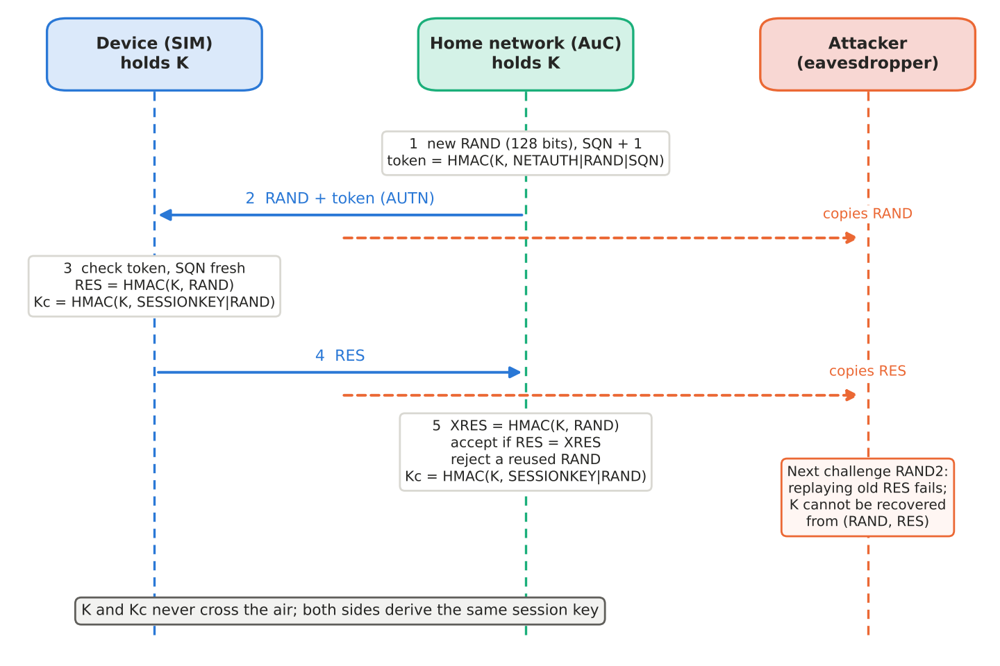
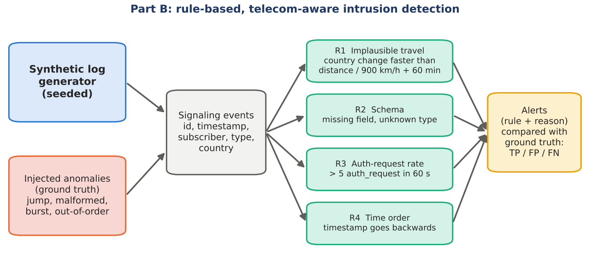
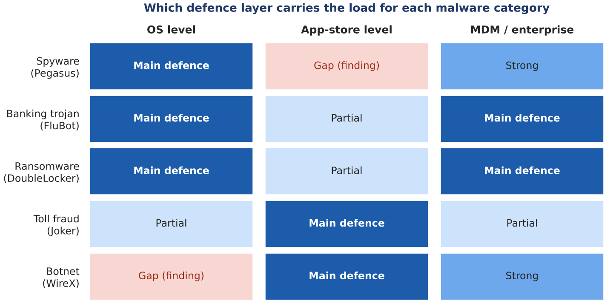
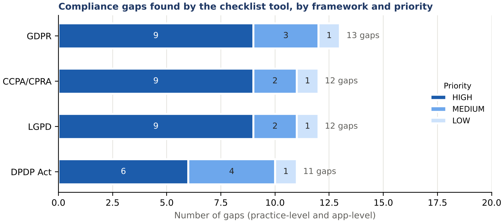

# Mobile Communications – Unit 5 Lab (Mini Projects 5.1 – 5.3)

University of Rwanda, Gako Campus · Computer Engineering · Year 4 · Group assignment

| Member | Reg. No. |
|---|---|
| Janvier NSHIMIYIMANA | 223026679 |
| Blandon ASHIMIRWE | 223026675 |
| Gilbert HIRWA NTWALI | 223026689 |

The full written report (Word) is submitted separately. This repository holds the code and the generated outputs.

## Contents

| Folder | Mini project | What it does |
|---|---|---|
| `mp5_1_auth_and_ids/part_a_mutual_auth.py` | 5.1 Part A | HMAC-SHA256 challenge-response authentication (GSM A3/A8 / AKA style), failed forgery, replay protection, mutual authentication |
| `mp5_1_auth_and_ids/part_b_signaling_ids.py` | 5.1 Part B | Synthetic signaling log + rule-based IDS (travel, schema, auth-rate, timestamp-order rules) and threshold tuning |
| `mp5_2_malware_matrix/mitigation_matrix.py` | 5.2 | Malware case studies and the OS / app-store / MDM control matrix, exported to CSV and Markdown |
| `mp5_3_privacy_checklist/privacy_checklist.py` | 5.3 | Checks a hypothetical app (`app_profile.json`) against GDPR, CCPA/CPRA, LGPD and the DPDP Act and prints a gap report |
| `outputs/` | all | Captured console output, CSV and JSON results |

## How to run

Python 3.8 or newer, **standard library only** (nothing to install).

Windows: double-click `run_all.bat` (or run it from a terminal).
Linux/macOS: `./run_all.sh`

Each script can also be run on its own, for example:

```
python mp5_1_auth_and_ids\part_a_mutual_auth.py
```

Note: Part A uses fresh random keys and challenges, so its hex values change on every run. Part B uses fixed seeds, so its results repeat exactly.

## Diagrams

| | |
|---|---|
|  |  |
| 5.1 Part A: challenge-response authentication | 5.1 Part B: rule-based intrusion detection |
|  |  |
| 5.2: defence layer per malware category | 5.3: compliance gaps per framework |
